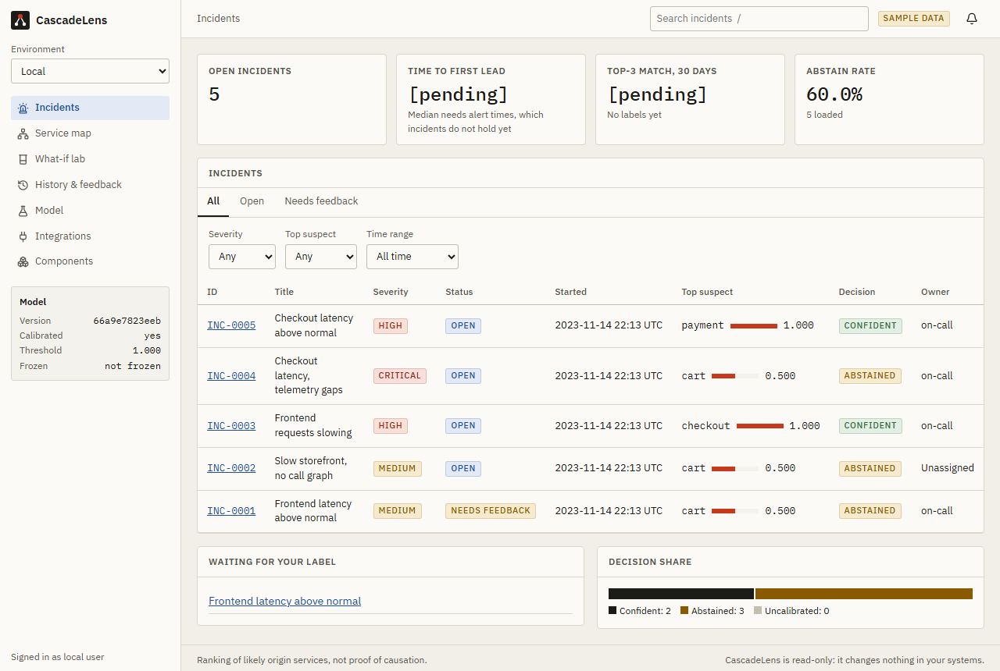
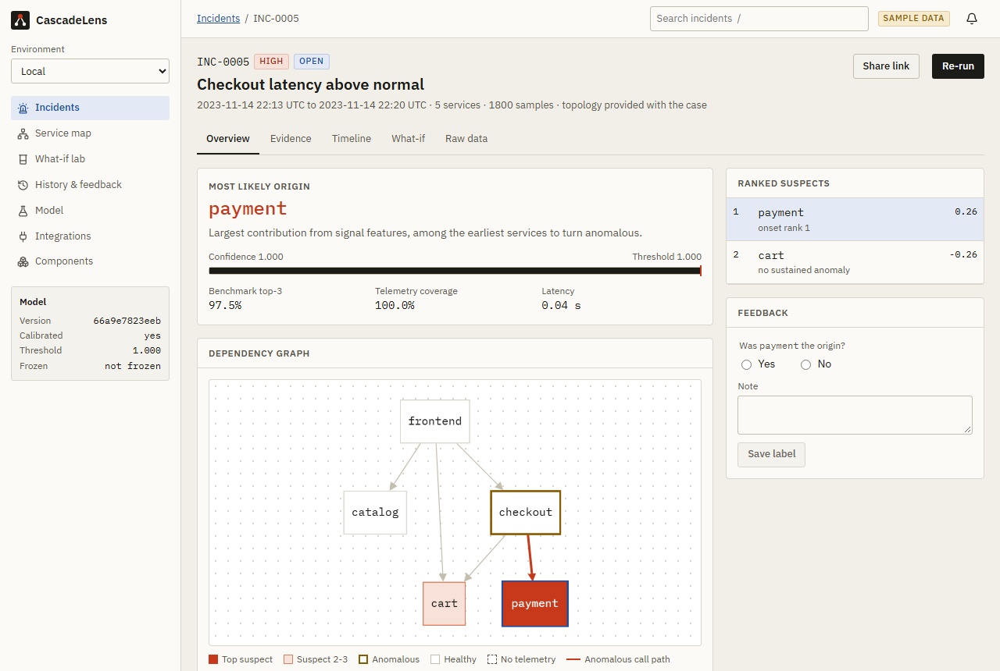
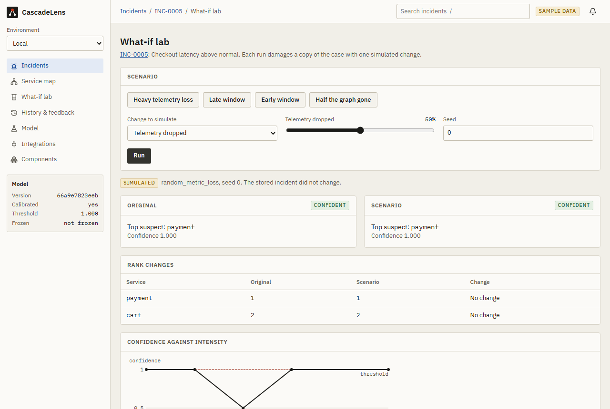

# CascadeLens

CascadeLens ranks the likely origin services of a microservice incident from metrics, and is built
to stay honest when telemetry is imperfect. It pairs a two-stage LightGBM ranker with an evaluation
harness: leakage-safe splits, a perturbation suite, paired group-bootstrap statistics, calibration
and abstention. It gives a ranking of likely origin services, not proof of causation. It is a decision aid for read-only analysis, not an
autonomous operator.

**Status: exploratory.** No config is frozen, so ranker verdicts below preview the pre-registered
tests in [PREREGISTRATION.md](PREREGISTRATION.md). Regenerate them after a freeze.

## Headline results

Each cell is read from a committed result JSON, and
[provenance](docs/results/provenance.md) traces it. S1 to S5 are Top-1 points unless stated, with
paired 95% group-bootstrap intervals. P2 results are simulated.

<!-- generated:headline; regenerate with: python -m cascadelens.report build -->

| Criterion | Measure | Result [95% CI] | Holm p | Verdict |
| --- | --- | --- | --- | --- |
| S1 | Ranker minus frequency prior, Top-1 points, group_run | 68.7 [58.8, 77.9] | 0.0016 | pass |
| S2 | Ranker minus lightgbm_flat, plus the 12-point margin | 6.7 [2.8, 10.2] | 0.0016 | pass |
| S3 vs lightgbm_flat | Margin growth, P2 at 30% (simulated) | 16.7 [11.0, 22.5] | 0.0016 | pass |
| S3 vs lightgbm_flat_masking | Margin growth, P2 at 30% (simulated) | 14.8 [9.0, 20.8] | 0.0016 | pass |
| S3 vs frequency | Margin growth, P2 at 30% (simulated) | -14.0 [-19.0, -9.4] | 0.0016 | fail |
| S3 vs rule | Margin growth, P2 at 30% (simulated) | -12.7 [-18.1, -7.7] | 0.0016 | fail |
| S3 vs rule_upstream | Margin growth, P2 at 30% (simulated) | -11.4 [-16.9, -6.1] | 0.0016 | fail |
| S3 vs baro | Margin growth, P2 at 30% (simulated) | -18.0 [-24.1, -12.2] | 0.0016 | fail |
| S4 | Top-1 at 50% coverage minus full coverage and random abstention | 11.0 [7.0, 15.2] | 0.0018 | pass |
| S5 (secondary) | ECE after minus ECE before calibration | -0.187 [-0.240, -0.118] | - | pass |
| S6 | Fresh clone plus one command regenerates all tables on the real data | 2026-11-01 full | - | pass |
| S7 baro (observed) | Reproduced Avg@5 within tolerance on all three suites | see the reproduction table | - | pass |
| S7 lingam_randomwalk (observed) | Reproduced Avg@5 within tolerance on all three suites | see the reproduction table | - | fail |

<!-- /generated -->

The ranker does not beat flat LightGBM on clean data: -5.3 [-9.2, -1.8] points without the margin.
S2 passing rules out a deficit of 12 points or more and says nothing stronger. S3 is split: it
passes against both LightGBM flats and fails against the four non-learned baselines. See the
[report](docs/REPORT.md) for the causes.

## Quickstart

Needs [uv](https://docs.astral.sh/uv/), make and Python 3.11. These run on a committed fixture, with
no download.

```bash
make install
```

```bash
make test
```

```bash
make smoke
```

## Web UI

A local, read-only interface for incidents: ranked suspects, the dependency graph, evidence, simulated
what-if runs, feedback and the committed model results. Sample incidents are synthetic and labelled
as sample data. There is no sign-in, so keep it on this machine and never expose it publicly.

```bash
make web-install
```

```bash
make web-build
```

```bash
python scripts/seed_demo.py
```

```bash
cascadelens serve --ui
```

Open <http://localhost:8000>. For development, `make dev` runs the API and the Vite server together.
The API needs a saved model; [the demo guide](docs/demo/README.md) shows how to train one.







## Repository map

```text
configs/      experiment settings
src/          ingestion, splits, baselines, features, ranker, evaluation, API, demo, report
experiments/  configs and committed result JSONs
docs/         report, generated results, audits, reproduction notes
scripts/      reproduction, environment checks, smoke run, clean-clone check
tests/        unit, property, leakage, API, demo and reproduction tests
web/          React UI, with component, end-to-end and accessibility tests
demo_data/    small synthetic sample cases
```

## How to reproduce

The data is not in this repository. Download RE1 from
[RCAEval](https://github.com/phamquiluan/RCAEval), accept its terms, and place the suites at:

```text
data/raw/RE1-OB/<service>_<fault>/<n>/data.csv
data/raw/RE1-SS/...
data/raw/RE1-TT/...
```

```bash
bash scripts/reproduce_all.sh
```

This checks Python, disk, memory and the data, then runs `make all`. Finished stages are skipped
when their inputs are unchanged. It downloads nothing unless you pass `--download`, because the
dataset's license is yours to accept. See [the reproduction log](docs/results/reproduction_log.md)
for what has actually been run.

To refresh documents from committed results:

```bash
python -m cascadelens.report build
```

## Freezing the config

Every result is tagged exploratory until a config is frozen. Run this once, after you have stopped
changing `configs/ranker.yaml`, `configs/augment.yaml`, `configs/calibration.yaml` and the feature
config, and before the final reported run:

```bash
cascadelens freeze --name final
```

It records each ranker variant's validation choice for every fold under the config hash, in
`configs/frozen/final.yaml`, using training and validation cases only. Then rerun without
`--exploratory` by setting `FROZEN=1`. A frozen record is never rewritten, and any later config
change needs a new name and a disclosed amendment in [PREREGISTRATION.md](PREREGISTRATION.md).

## Baselines

- Frequency prior, earliest onset (`rule`), max anomaly (`rule_upstream`) and LightGBM over flat
  features: implemented here.
- BARO: Pham, Ha, Zhang. *BARO: Robust Root Cause Analysis for Microservices via Multivariate
  Bayesian Online Change Point Detection*. FSE 2024, arXiv 2405.09330.
- ICA-LiNGAM with random walk: from Pham, Ha, Zhang. *Root Cause Analysis for Microservice System
  based on Causal Inference: How Far Are We?* ASE 2024, arXiv 2408.13729.

Both published methods run through RCAEval 1.11.0. See
[the reproduction plan](docs/reproduction/PLAN.md).

## Limitations

- Three systems and few groups, so intervals are wide and only large effects are detectable.
- Faults are injected in benchmarks. Nothing is validated on production data.
- Topology is static or inferred. This does not model a changing topology.
- Perturbations are simulated, except held-out fault types and systems.
- The window depends on the injection indirectly: 98.9% of injections sit within 2% of
  the window's middle.
- This is a ranking, not causal discovery.

## License and data notice

Code is under the [MIT License](LICENSE). The RCAEval data is not redistributed here. As checked on
2026-11-06, the RCAEval README releases its datasets under the MIT License, and the Zenodo record
that `--download` uses ([DOI 10.5281/zenodo.14590730](https://doi.org/10.5281/zenodo.14590730))
lists CC BY 4.0. Both allow use with attribution, so cite the dataset when you use it. This is a
summary, not legal advice.

## Citation

See [CITATION.cff](CITATION.cff).

## Disclaimer

CascadeLens gives a ranking of likely origin services, not proof of causation. It takes no action on any system.
