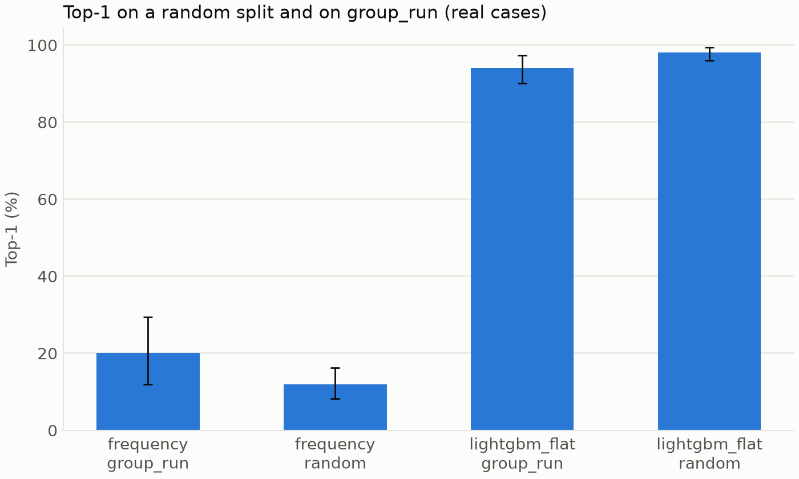
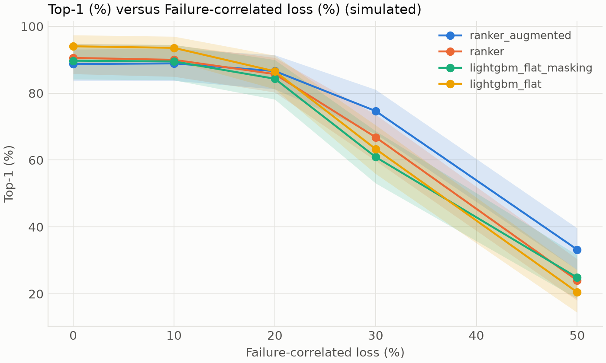
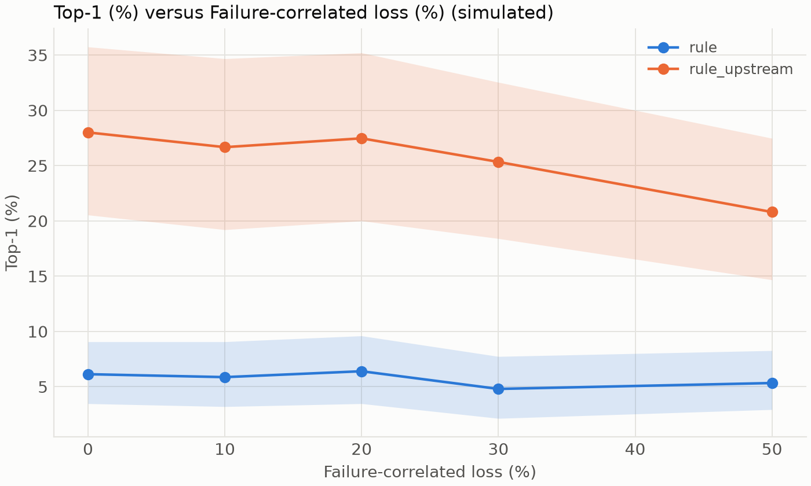
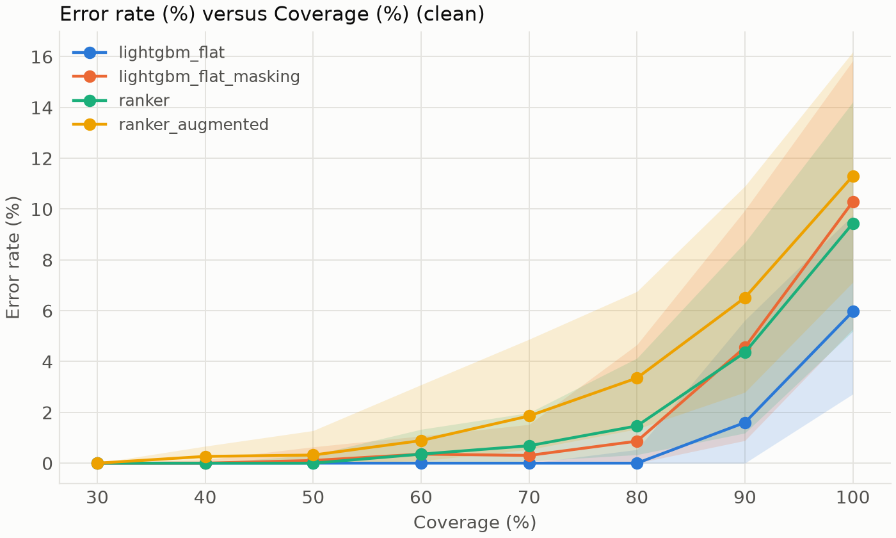

# CascadeLens: root-cause service ranking under imperfect telemetry

**Status: exploratory.** No config is frozen, so every ranker verdict here previews the pre-registered
test. All tables are generated from committed result JSONs, traced in
[provenance](results/provenance.md).

## Abstract

Root-cause ranking methods for microservices are usually scored on clean telemetry and on splits
that can leak near-duplicate runs. We built an evaluation harness with grouped splits, leakage
probes, a perturbation suite and paired group-bootstrap statistics, and used it to test a
missingness-aware two-stage LightGBM ranker on 375 RE1 cases from RCAEval. On clean data
the ranker was non-inferior to the best baseline within a 12-point margin, but flat LightGBM stayed
ahead by -5.3 [-9.2, -1.8] points. Under simulated failure-correlated loss the ranker's margin over
both LightGBM baselines grew, by 16.7 [11.0, 22.5] and 14.8 [9.0, 20.8] points, while its margin over
non-learned baselines shrank. Calibrated abstention at 50% coverage raised Top-1 by 11.0 [7.0, 15.2] points.
Feature ablation found that only signal features mattered measurably on this benchmark. The system
gives a ranking of likely origin services, not proof of causation.

**Contributions.** A reusable leakage-aware harness, a pre-registered evaluation including failed
criteria, a quantified random-split inflation, and calibrated abstention tested under shift.

## Background and related work

Root-cause analysis work spans metric-based, trace-based, graph-based, causal and LLM-based methods.
[VERIFY: survey citations for each family are not in this repository]

Two works are confirmed from the repository's reproduction notes. BARO (Pham, Ha, Zhang, FSE 2024,
arXiv 2405.09330) detects change points per metric. The ASE 2024 evaluation by the same authors
(arXiv 2408.13729) studied causal methods for this task, including ICA-LiNGAM with random walk.

Benchmark critiques, and the claims in the PRD's motivation, remain unverified and are not repeated
here. [VERIFY: benchmark-critique citations] See the [claims list](CLAIMS_TODO.md).

## Benchmarks and Case schema

We use RE1 from RCAEval: 375 metrics-only cases across Online Boutique, Sock Shop and Train
Ticket, with five fault types and five repetitions per injection, as audited in
[the data audit](data_audit.md). A `Case` holds a long metrics table of service, metric, timestamp
and value, a window, an optional topology, and ground-truth fields that feature code cannot read.
A missing sample is a null row, never imputed. RE1 records no topology, so graphs are inferred per
case from pre-incident latency, chosen by stability across repetitions without labels. They have not
been validated against real call graphs.

## Evaluation protocol

**Splits.** `group_run` holds out whole injection runs. LOFO holds out a fault type, and LOSO holds
out a system. Group overlap between train, validation and test is checked by code.

**Statistics.** Intervals are percentile group bootstraps with 10,000 resamples over seed-averaged
cases. All comparisons are paired, and overlapping intervals are never used. Holm correction covers
the primary family, and exploratory results show effect sizes only.

**Pre-registration.** Criteria S1 to S7 are fixed in `PREREGISTRATION.md`, which discloses what was
known when it took effect. Amendments there cover inferred graphs, the `rule_upstream` tie-break,
the one-thread Stage 2 setting, the P2 label leak, and the reading of "baselines" in S3. That last
amendment keeps every comparator, so S3 is not narrowed after the fact.

**Leakage probes.** Four probes test identity, graph-only skill, window leakage and mask-only skill.

<!-- generated:probes; regenerate with: python -m cascadelens.report build -->

| Probe | Result | Outcome |
| --- | --- | --- |
| Identity | drop, graph and structural shuffled: 0.2 [-1.5, 1.9] | pass |
| Graph-only | Top-1 group_run 12.3 [9.0, 15.8], loso 7.4 [5.5, 9.4] | pass |
| Window leak | no cliff at zero; 98.9% of injections sit within 2% of the window's middle | pass |
| Mask-only | Top-1 31.5 [22.9, 40.7] on clean data, uniform floor 4.4 | flagged |

<!-- /generated -->

The window definition does not read `inject_time`, but 98.9% of injections sit within 2%
of the window's middle, so it depends on the injection indirectly and strongly. The mask-only flag
means missingness alone reaches 31.5 [22.9, 40.7], against a floor of 4.4.

## Baselines and reproduction

Supervised baselines are a frequency prior and LightGBM over flat features. Unsupervised baselines
are `rule`, `rule_upstream`, BARO and ICA-LiNGAM with random walk.

<!-- generated:reproduction; regenerate with: python -m cascadelens.report build -->

| Method | Suite | Published Avg@5 | Reproduced | Difference | Within tolerance |
| --- | --- | --- | --- | --- | --- |
| baro | RE1-OB | 0.906 | 0.896 | -0.010 | pass |
| baro | RE1-SS | 0.954 | 0.960 | +0.006 | pass |
| baro | RE1-TT | 0.826 | 0.779 | -0.047 | pass |
| lingam_randomwalk | RE1-OB | 0.290 | 0.312 | +0.022 | pass |
| lingam_randomwalk | RE1-SS | 0.448 | 0.512 | +0.064 | fail |
| lingam_randomwalk | RE1-TT | 0.096 | 0.072 | -0.024 | pass |

<!-- /generated -->

S7 is an observed result, because reproduction finished before the pre-registration took effect.
BARO reproduces within tolerance. ICA-LiNGAM misses on Sock Shop by +0.064 against a 0.05
tolerance. See [the reproduction plan](reproduction/PLAN.md) for the causes considered.

## CascadeLens method

Stage 1 is a LightGBM scorer over per-service features that retrieves K candidates, with
out-of-fold scores for training Stage 2. Stage 2 is a LightGBM LambdaRank reranker. The tuning budget
equals flat LightGBM's, and K is drawn inside it. Features fall into signal, temporal, graph,
structural and mask groups, and service identity is refused as a feature.

Missingness-aware training adds copies of training cases with random and failure-correlated masks,
computed without ground truth, and features are recomputed on the masked series. Each copy keeps its
group. Confidence is a softmax over candidate scores, calibrated on each fold's validation cases
pooled across seeds. Those cases are not pooled across folds, because validation cases of one fold
are test cases of another. The system abstains below a threshold chosen on validation.

## Results

<!-- generated:headline; regenerate with: python -m cascadelens.report build -->

| Criterion | Measure | Result [95% CI] | Holm p | Verdict |
| --- | --- | --- | --- | --- |
| S1 | Ranker minus frequency prior, Top-1 points, group_run | 68.7 [58.8, 77.9] | 0.0016 | pass |
| S2 | Ranker minus lightgbm_flat, plus the 12-point margin | 6.7 [2.8, 10.2] | 0.0016 | pass |
| S3 vs lightgbm_flat | Margin growth, P2 at 30% (simulated) | 16.7 [11.0, 22.5] | 0.0016 | pass |
| S3 vs lightgbm_flat_masking | Margin growth, P2 at 30% (simulated) | 14.8 [9.0, 20.8] | 0.0016 | pass |
| S3 vs frequency | Margin growth, P2 at 30% (simulated) | -14.0 [-19.0, -9.4] | 0.0016 | fail |
| S3 vs rule | Margin growth, P2 at 30% (simulated) | -12.7 [-18.1, -7.7] | 0.0016 | fail |
| S3 vs rule_upstream | Margin growth, P2 at 30% (simulated) | -11.4 [-16.9, -6.1] | 0.0016 | fail |
| S3 vs baro | Margin growth, P2 at 30% (simulated) | -18.0 [-24.1, -12.2] | 0.0016 | fail |
| S4 | Top-1 at 50% coverage minus full coverage and random abstention | 11.0 [7.0, 15.2] | 0.0018 | pass |
| S5 (secondary) | ECE after minus ECE before calibration | -0.187 [-0.240, -0.118] | - | pass |
| S6 | Fresh clone plus one command regenerates all tables on the real data | 2026-11-01 full | - | pass |
| S7 baro (observed) | Reproduced Avg@5 within tolerance on all three suites | see the reproduction table | - | pass |
| S7 lingam_randomwalk (observed) | Reproduced Avg@5 within tolerance on all three suites | see the reproduction table | - | fail |

<!-- /generated -->

### Leakage

<!-- generated:leakage; regenerate with: python -m cascadelens.report build -->

| Method | Top-1 group_run | Top-1 random | Random minus group_run |
| --- | --- | --- | --- |
| frequency | 20.0 [12.0, 29.3] | 12.0 [8.3, 16.3] | -8.0 [-18.4, 1.9] |
| lightgbm_flat | 94.0 [90.1, 97.4] | 98.0 [96.1, 99.5] | 4.0 [0.8, 7.7] |

<!-- /generated -->

The random split inflates flat LightGBM by 4.0 [0.8, 7.7] points. This is a real effect on real cases,
though its interval is wide.

### Clean performance

<!-- generated:clean_supervised; regenerate with: python -m cascadelens.report build -->

| Method | Top-1 | Top-3 | Avg@5 |
| --- | --- | --- | --- |
| frequency | 20.0 [12.0, 29.3] | 60.0 [48.0, 70.7] | 60.0 [53.6, 66.7] |
| lightgbm_flat | 94.0 [90.1, 97.4] | 98.6 [97.0, 99.7] | 97.7 [96.0, 99.1] |
| two_stage_ranker | 90.6 [85.8, 94.8] | 97.5 [95.7, 99.0] | 96.1 [93.9, 98.0] |
| single_stage_ranker | 91.2 [86.7, 95.0] | 97.0 [94.4, 99.1] | 96.2 [93.7, 98.2] |

<!-- /generated -->

<!-- generated:clean_unsupervised; regenerate with: python -m cascadelens.report build -->

| Method | Top-1 | Top-3 | Avg@5 |
| --- | --- | --- | --- |
| rule | 6.1 [3.5, 9.1] | 18.1 [13.9, 22.7] | 18.8 [14.7, 22.9] |
| rule_upstream | 28.0 [20.5, 35.7] | 45.3 [36.3, 54.7] | 45.8 [37.8, 54.0] |
| baro | 30.1 [21.9, 38.4] | 53.9 [45.9, 62.1] | 53.3 [45.9, 60.7] |
| lingam_randomwalk | 8.8 [3.7, 14.9] | 18.7 [11.7, 26.1] | 17.3 [11.2, 24.1] |

<!-- /generated -->

Supervised and unsupervised methods should be compared descriptively only. Flat LightGBM is the best
method on clean data. The plain ranker's difference from it is -3.5 [-6.2, -0.9] points, and the
augmented ranker's is -5.3 [-9.2, -1.8].

### Robustness

P1 to P8 and P11 to P13 are simulated. P9 and P10 are held-out splits.

<!-- generated:robustness; regenerate with: python -m cascadelens.report build -->

| Point | Label | ranker_augmented | ranker | lightgbm_flat_masking | lightgbm_flat | frequency |
| --- | --- | --- | --- | --- | --- | --- |
| clean | clean | 88.7 [83.6, 93.1] | 90.6 [85.8, 94.8] | 89.7 [84.2, 94.7] | 94.0 [90.1, 97.4] | 20.0 [12.0, 29.3] |
| P1:level=series,rate=0.3 | simulated | 83.9 [78.6, 88.6] | 84.6 [79.1, 89.5] | 84.6 [78.7, 89.9] | 84.7 [79.4, 89.4] | 20.0 [12.0, 29.3] |
| P2:after_boost=3.0,near_boost=3.0,rate=0.2 | simulated | 86.6 [81.2, 91.4] | 85.7 [80.3, 90.6] | 84.3 [78.1, 90.0] | 86.6 [81.2, 91.3] | 20.0 [12.0, 29.3] |
| P2:after_boost=3.0,near_boost=3.0,rate=0.3 | simulated | 74.7 [67.8, 81.1] | 66.8 [59.8, 73.6] | 60.9 [53.1, 68.7] | 63.3 [55.9, 70.5] | 20.0 [12.0, 29.3] |
| P2:after_boost=3.0,near_boost=3.0,rate=0.5 | simulated | 33.2 [27.1, 39.6] | 24.0 [18.0, 30.4] | 24.9 [18.5, 31.6] | 20.5 [14.4, 27.1] | 20.0 [12.0, 29.3] |
| P3:family=latency | simulated | 70.8 [62.6, 78.9] | 71.9 [63.9, 79.7] | 68.8 [59.9, 77.3] | 68.4 [59.5, 77.1] | 20.0 [12.0, 29.3] |
| P3:family=memory | simulated | 75.9 [69.2, 82.2] | 79.8 [73.3, 85.9] | 87.3 [81.2, 92.6] | 87.9 [82.6, 92.6] | 20.0 [12.0, 29.3] |
| P4:offset_seconds=-120 | simulated | 77.9 [71.4, 84.1] | 72.5 [65.8, 79.1] | 58.2 [49.2, 67.3] | 61.3 [52.7, 70.0] | 20.0 [12.0, 29.3] |
| P6:rate=0.3 | simulated | 88.9 [83.8, 93.2] | 90.6 [85.8, 94.8] | 89.7 [84.2, 94.7] | 94.0 [90.1, 97.4] | 20.0 [12.0, 29.3] |
| P8:method=correlation | simulated | 89.1 [84.1, 93.3] | 90.5 [85.5, 94.8] | 89.7 [84.2, 94.7] | 94.0 [90.1, 97.4] | 20.0 [12.0, 29.3] |
| P11:factor=5 | simulated | 85.1 [79.0, 90.5] | 87.8 [82.5, 92.5] | 88.8 [83.0, 93.9] | 89.5 [84.2, 94.3] | 20.0 [12.0, 29.3] |
| P13:mode=rename,service_fraction=0.3 | simulated | 80.2 [74.0, 85.9] | 84.9 [79.7, 89.8] | 86.8 [81.0, 92.2] | 88.7 [84.0, 93.0] | 20.0 [12.0, 29.3] |

<!-- /generated -->

At 30% failure-correlated loss (simulated), `ranker_augmented` scores 74.7 [67.8, 81.1], the plain
ranker 66.8 [59.8, 73.6], flat LightGBM 63.3 [55.9, 70.5] and the augmentation-matched flat 60.9 [53.1, 68.7]. The
full grid is in [the robustness table](results/tables/robustness_full.md).

### Ablations

<!-- generated:ablation; regenerate with: python -m cascadelens.report build -->

| Variant | Clean | P2 at 30% (simulated) |
| --- | --- | --- |
| ablate_signal | 63.1 [56.0, 69.8] | 53.5 [45.7, 60.9] |
| ablate_temporal | -2.2 [-4.3, -0.4] | -0.1 [-2.0, 1.7] |
| ablate_graph | -0.4 [-1.9, 1.0] | -0.4 [-2.8, 1.8] |
| ablate_structural | -0.6 [-2.7, 1.4] | 1.5 [-0.4, 3.5] |
| ablate_mask | 0.5 [-1.4, 2.7] | 3.2 [1.2, 5.2] |
| single_stage_augmented | -1.8 [-5.7, 1.9] | 7.7 [3.6, 11.9] |

<!-- /generated -->

Signal features carry the ranker: removing them costs 63.1 [56.0, 69.8] points. Removing graph
features changes -0.4 [-1.9, 1.0], and removing temporal features changes -2.2 [-4.3, -0.4], so
neither helps measurably on clean data. The graph here is inferred, which may be part of the reason.
The single-stage version ties on clean data (-1.8 [-5.7, 1.9]), and the two stages add
7.7 [3.6, 11.9] under simulated P2 loss.

### Calibration

Reliability diagrams and per-slice risk-coverage curves are in
`experiments/calibration/figures/`.

<!-- generated:calibration; regenerate with: python -m cascadelens.report build -->

| Method | Slice | ECE before | ECE after | ECE difference | Top-1 at 50% | AURC / random / oracle | Test coverage % |
| --- | --- | --- | --- | --- | --- | --- | --- |
| lightgbm_flat | clean | 0.210 [0.177, 0.248] | 0.029 [0.016, 0.056] | -0.181 [-0.210, -0.143] | 100.0 [100.0, 100.0] | 0.004 / 0.060 / 0.002 | 53.4 |
| lightgbm_flat | P2 30% (simulated) | 0.173 [0.122, 0.224] | 0.156 [0.110, 0.214] | -0.017 [-0.107, 0.087] | 86.1 [79.7, 90.9] | 0.216 / 0.367 / 0.078 | 25.8 |
| lightgbm_flat | P4 -120 s (simulated) | 0.259 [0.185, 0.333] | 0.150 [0.105, 0.211] | -0.109 [-0.210, 0.012] | 80.3 [70.2, 87.3] | 0.254 / 0.387 / 0.087 | 17.5 |
| lightgbm_flat | lofo (held-out) | 0.262 [0.206, 0.318] | 0.077 [0.039, 0.134] | -0.186 [-0.259, -0.093] | 90.7 [86.5, 94.6] | 0.126 / 0.110 / 0.006 | 53.1 |
| lightgbm_flat | loso (held-out) | 0.349 [0.292, 0.407] | 0.177 [0.121, 0.237] | -0.172 [-0.275, -0.062] | 94.1 [94.1, 94.1] | 0.097 / 0.270 / 0.040 | 62.3 |
| lightgbm_flat_masking | clean | 0.404 [0.345, 0.461] | 0.018 [0.015, 0.048] | -0.386 [-0.434, -0.308] | 99.9 [99.4, 100.0] | 0.011 / 0.103 / 0.006 | 39.8 |
| lightgbm_flat_masking | P2 30% (simulated) | 0.287 [0.222, 0.355] | 0.135 [0.082, 0.196] | -0.152 [-0.263, -0.033] | 86.0 [77.3, 93.2] | 0.156 / 0.391 / 0.089 | 12.8 |
| lightgbm_flat_masking | P4 -120 s (simulated) | 0.318 [0.244, 0.394] | 0.098 [0.051, 0.165] | -0.220 [-0.332, -0.089] | 81.9 [69.4, 90.5] | 0.203 / 0.418 / 0.103 | 7.8 |
| lightgbm_flat_masking | lofo (held-out) | 0.314 [0.256, 0.370] | 0.039 [0.016, 0.085] | -0.275 [-0.342, -0.184] | 99.8 [99.1, 100.0] | 0.018 / 0.113 / 0.007 | 33.7 |
| lightgbm_flat_masking | loso (held-out) | 0.325 [0.245, 0.399] | 0.075 [0.041, 0.126] | -0.250 [-0.340, -0.135] | 92.2 [90.0, 94.7] | 0.077 / 0.198 / 0.021 | 57.7 |
| ranker | clean | 0.282 [0.229, 0.337] | 0.014 [0.011, 0.038] | -0.268 [-0.307, -0.206] | 100.0 [99.7, 100.0] | 0.011 / 0.094 / 0.005 | 46.6 |
| ranker | P2 30% (simulated) | 0.189 [0.130, 0.247] | 0.130 [0.086, 0.182] | -0.060 [-0.155, 0.045] | 90.9 [84.9, 95.6] | 0.125 / 0.332 / 0.062 | 23.8 |
| ranker | P4 -120 s (simulated) | 0.294 [0.236, 0.353] | 0.069 [0.046, 0.108] | -0.225 [-0.300, -0.135] | 92.9 [87.0, 96.5] | 0.099 / 0.275 / 0.042 | 19.2 |
| ranker | lofo (held-out) | 0.243 [0.190, 0.296] | 0.027 [0.017, 0.058] | -0.216 [-0.267, -0.144] | 100.0 [99.8, 100.0] | 0.014 / 0.111 / 0.006 | 46.3 |
| ranker | loso (held-out) | 0.283 [0.227, 0.341] | 0.099 [0.069, 0.144] | -0.184 [-0.251, -0.105] | 88.7 [85.9, 91.2] | 0.125 / 0.167 / 0.015 | 50.9 |
| ranker_augmented | clean | 0.219 [0.177, 0.260] | 0.032 [0.014, 0.065] | -0.187 [-0.240, -0.118] | 99.7 [98.7, 100.0] | 0.018 / 0.113 / 0.007 | 48.4 |
| ranker_augmented | P2 30% (simulated) | 0.179 [0.127, 0.230] | 0.112 [0.069, 0.165] | -0.067 [-0.156, 0.034] | 93.9 [88.3, 97.8] | 0.080 / 0.253 / 0.035 | 31.3 |
| ranker_augmented | P4 -120 s (simulated) | 0.233 [0.186, 0.280] | 0.070 [0.037, 0.116] | -0.163 [-0.236, -0.074] | 96.2 [92.1, 98.6] | 0.066 / 0.221 / 0.027 | 30.7 |
| ranker_augmented | lofo (held-out) | 0.243 [0.193, 0.296] | 0.024 [0.015, 0.056] | -0.219 [-0.270, -0.151] | 98.6 [97.1, 99.7] | 0.020 / 0.108 / 0.006 | 45.6 |
| ranker_augmented | loso (held-out) | 0.372 [0.329, 0.414] | 0.111 [0.074, 0.158] | -0.261 [-0.335, -0.176] | 87.6 [84.9, 90.9] | 0.138 / 0.189 / 0.019 | 46.8 |

<!-- /generated -->

<!-- generated:selective; regenerate with: python -m cascadelens.report build -->

| Coverage % | lightgbm_flat | lightgbm_flat_masking | ranker | ranker_augmented |
| --- | --- | --- | --- | --- |
| 30.0 | 100.0 [100.0, 100.0] | 100.0 [100.0, 100.0] | 100.0 [100.0, 100.0] | 100.0 [100.0, 100.0] |
| 40.0 | 100.0 [100.0, 100.0] | 100.0 [99.9, 100.0] | 100.0 [100.0, 100.0] | 99.7 [99.3, 100.0] |
| 50.0 | 100.0 [100.0, 100.0] | 99.9 [99.4, 100.0] | 100.0 [99.7, 100.0] | 99.7 [98.7, 100.0] |
| 60.0 | 100.0 [100.0, 100.0] | 99.6 [98.9, 100.0] | 99.6 [98.7, 100.0] | 99.1 [96.9, 99.9] |
| 70.0 | 100.0 [100.0, 100.0] | 99.7 [98.5, 100.0] | 99.3 [98.0, 99.9] | 98.1 [95.1, 99.5] |
| 80.0 | 100.0 [99.5, 100.0] | 99.1 [95.3, 100.0] | 98.5 [95.9, 99.7] | 96.6 [93.2, 98.7] |
| 90.0 | 98.4 [94.4, 100.0] | 95.4 [90.0, 99.1] | 95.6 [91.3, 98.8] | 93.5 [89.1, 97.2] |
| 100.0 | 94.0 [90.2, 97.3] | 89.7 [84.2, 94.7] | 90.6 [85.8, 94.8] | 88.7 [83.8, 92.9] |

<!-- /generated -->

<!-- generated:coverage_drift; regenerate with: python -m cascadelens.report build -->

| Slice | Label | Test coverage % | Range across folds |
| --- | --- | --- | --- |
| P2:after_boost=3.0,near_boost=3.0,rate=0.3 | simulated | 31.3 | 20.8 to 47.7 |
| P4:offset_seconds=-120 | simulated | 30.7 | 23.7 to 47.2 |
| P4:offset_seconds=-30 | simulated | 45.8 | 38.1 to 60.3 |
| P4:offset_seconds=-60 | simulated | 45.9 | 36.3 to 60.5 |
| P4:offset_seconds=120 | simulated | 46.2 | 39.2 to 61.9 |
| P4:offset_seconds=30 | simulated | 47.6 | 40.8 to 61.9 |
| P4:offset_seconds=60 | simulated | 46.5 | 37.6 to 63.2 |
| clean | clean | 48.4 | 38.9 to 60.8 |
| lofo | held-out | 45.6 | 14.4 to 84.8 |
| loso | held-out | 46.8 | 14.6 to 89.9 |

<!-- /generated -->

ECE falls from 0.219 [0.177, 0.260] to 0.032 [0.014, 0.065], a paired difference of -0.187 [-0.240, -0.118]. S5 is an easy bar,
because ranking scores have no natural scale, so the uncalibrated value is partly arbitrary. AURC is
0.018, against 0.113 for random abstention and 0.007 for the oracle.

Coverage held near its target on clean data, at 48.4%, but fell to 31.3%
under simulated P2 loss and 30.7% under a 120 s early shift. This is the safe direction.
On held-out folds it was unstable, and the pooled figure hides that.

### Negative and null results

- **S3 against non-learned baselines failed.** Margins over frequency (-14.0 [-19.0, -9.4]), BARO
  (-18.0 [-24.1, -12.2]), `rule` and `rule_upstream` shrank. The likely cause is structural for the frequency
  prior: it reads no telemetry, so its score cannot fall, and any loss in the ranker shrinks the
  margin. The pre-registration does not limit "baselines" to learned ones, so this stands as a
  failure.
- **The ranker did not beat flat LightGBM on clean data.** S2 passing only rules out a 12-point
  deficit.
- **Graph features added nothing measurable.** The graph-aware design is not supported on this data.
- **Two stages did not help on clean data.**
- **Augmentation cost clean accuracy:** the ranker went from 90.6 [85.8, 94.8] to 88.7 [83.6, 93.1], and
  flat LightGBM from 94.0 [90.1, 97.4] to 89.7 [84.2, 94.7].
- **S6 covers exploratory results only.** The logged full run regenerated the committed tables, but no frozen config has been run.
- **ICA-LiNGAM missed tolerance on one system.**

## Failure analysis

<!-- generated:failure_fault; regenerate with: python -m cascadelens.report build -->

| Fault | Random floor | two_stage_ranker Top-1 | lightgbm_flat Top-1 |
| --- | --- | --- | --- |
| cpu | 4.3 | 99.7 [99.2, 100.0] | 98.7 [96.0, 100.0] |
| delay | 4.5 | 76.8 [65.6, 86.9] | 76.3 [59.7, 89.9] |
| disk | 4.6 | 97.3 [94.7, 99.5] | 95.5 [91.5, 98.9] |
| loss | 4.5 | 72.5 [57.1, 86.9] | 76.0 [59.2, 90.4] |
| mem | 4.3 | 98.1 [96.0, 100.0] | 98.7 [96.3, 100.0] |

<!-- /generated -->

<!-- generated:failure_system; regenerate with: python -m cascadelens.report build -->

| System | Random floor | two_stage_ranker Top-1 | lightgbm_flat Top-1 |
| --- | --- | --- | --- |
| online-boutique | 7.5 | 79.4 [68.8, 88.6] | 41.8 [27.7, 56.5] |
| sock-shop | 4.4 | 96.6 [92.2, 99.5] | 89.4 [79.2, 97.4] |
| train-ticket | 1.4 | 73.8 [62.6, 84.3] | 87.7 [79.2, 94.6] |

<!-- /generated -->

Delay and loss are the hard fault types, and Train Ticket and Online Boutique the hard systems. The
ranker generalises far better than flat LightGBM to an unseen Online Boutique, but worse to an unseen
Train Ticket, so neither method dominates on held-out systems. Per-fold intervals are wide, because
each fold holds few groups.

## Limitations

- **Small sample.** Three systems and 75 groups. Power analysis shows S3 can detect only large
  effects, so a null result means no effect of about 15 points or more, not no effect.
- **Injected faults.** Nothing here is validated on production incidents.
- **Static topology.** Graphs are inferred once per case. We do not model changing topology.
- **Simulated perturbations.** P1 to P8 and P11 to P13 are simulated. P2 uses ground truth to place
  gaps, so mask features may gain from the gaps revealing the fault: 3.2 [1.2, 5.2] points.
- **Window dependence.** Windows depend on `inject_time` indirectly, as described above.
- **Validation reuse.** Calibration uses validation cases that also steered early stopping and
  search.
- **Fragile training.** The reranker stops after few boosting rounds, and before the one-thread fix
  one group_run fold swung widely across settings.
- **Not causal discovery.** The output is a ranking.

## Reproducibility statement

Each result JSON records its config hash, git commit, data checksum and seed. `make all` runs every
stage, and a stage is skipped when its inputs are unchanged. `scripts/clean_clone_check.sh` verifies
a fresh clone on the committed fixture. That is not S6: S6 needs a full run from a fresh clone on
the real data, recorded in [the reproduction log](results/reproduction_log.md). The current verdict
is in the headline table. Results were not rerun to improve any number.

## Ethics and intended use

This is a read-only decision aid for defensive use. It is not an autonomous operator, and it is not
ready for production. A wrong ranking can mislead responders, so a person must check the evidence.
The dataset is not redistributed, and its license is the user's to check.
[VERIFY: RCAEval dataset license terms] See the [model card](../MODEL_CARD.md).

To export a PDF, install pandoc and run `pandoc docs/REPORT.md -o docs/REPORT.pdf`. Pandoc was not
available when this file was generated, so no PDF is committed.
