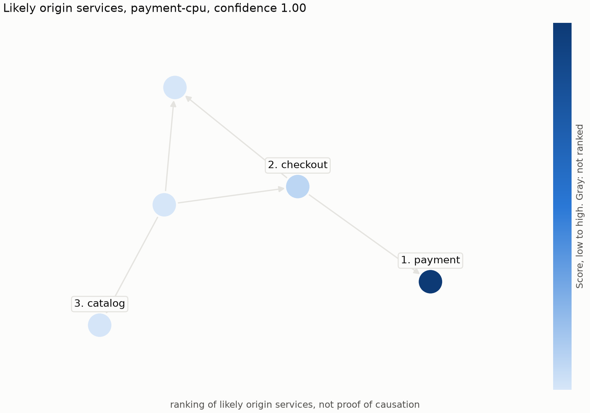
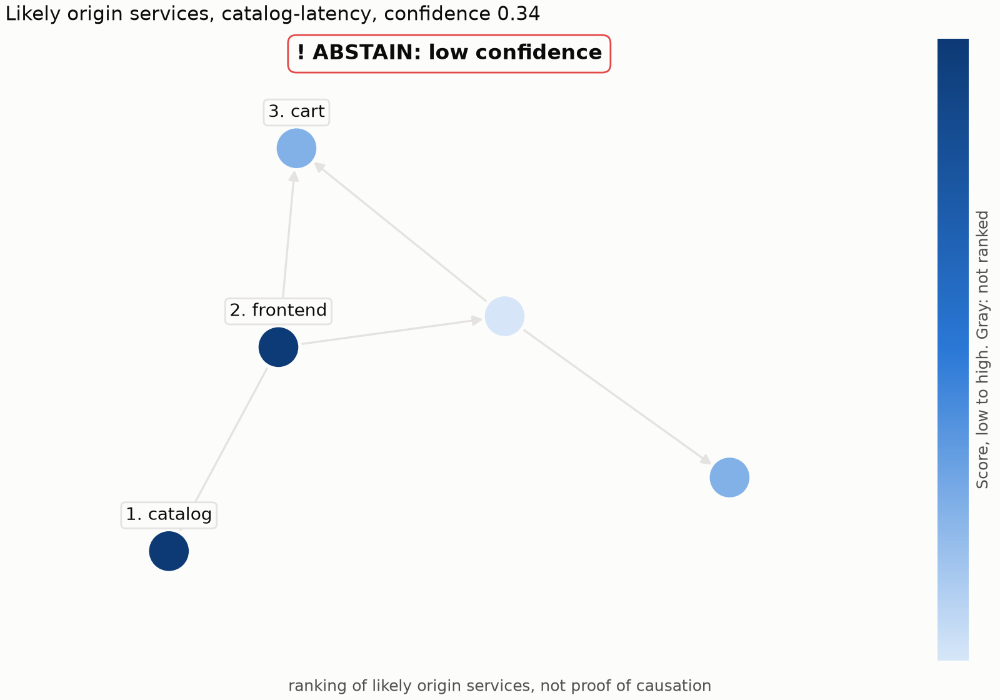

# CLI, API and demo

CascadeLens gives a ranking of likely origin services, not proof of causation. It is a read-only
decision aid: it changes nothing, and it makes no outbound request.

**The API has no authentication. Keep it on this machine and never expose it publicly.**

## Before you start

You need a trained model with a calibrator. Without a calibrator everything still runs, confidence
is marked uncalibrated, and nothing abstains.

```bash
uv sync --extra api --extra demo
```

```bash
cascadelens calibrate --config configs/ranker.yaml --split group_run
```

`calibrate` trains any model that is missing. Commands use the most recently saved model unless
you pass `--model <directory>`. That model comes from one training fold, not from all the data.

## CLI

```bash
cascadelens diagnose --case demo_data/payment-cpu.json
```

```bash
cascadelens diagnose --case demo_data/payment-cpu.json --format json
```

```bash
cascadelens demo-figure --case demo_data/payment-cpu.json --out fig.png
```

`--case` takes a JSON case or a Parquet metrics table with columns service, metric, timestamp and
value. A case with no topology is drawn as nodes without edges, and the figure says so.



Below the confidence threshold, the figure carries a banner:



## API

```bash
cascadelens serve --port 8000
```

It binds to 127.0.0.1. CORS is off, and the largest body is 25 MB unless you set
`--max-body-bytes`.

```bash
curl -s localhost:8000/health
```

```bash
curl -s localhost:8000/model-info
```

```bash
curl -s -X POST localhost:8000/diagnose -H "content-type: application/json" -d @demo_data/checkout-unlabelled.json
```

The body is `{case_id?, topology?: [{caller, callee}], metrics: [{service, metric, ts, value}],
window: {start, end}}`. A null `value` means the sample is missing. Timestamps may fall up to 60 s
outside the window, and such samples are ignored. Other sample files hold a `simulation` block,
which the API rejects as an unknown field, so post `checkout-unlabelled.json` or strip the block.

Invalid input gets a 422 with a message, and a body over the limit gets a 413. The built-in
`/docs` pages are off, because they load scripts from a public CDN.

## Web UI

```bash
make web-install
```

```bash
make web-build
```

```bash
python scripts/seed_demo.py
```

```bash
cascadelens serve --ui
```

Open <http://127.0.0.1:8000>. Incidents, labels and settings are kept in `data/app.db`, which
`--database` changes. For development, `make dev` runs the API and the Vite server together, and
`make e2e` runs the Playwright and accessibility tests on a tiny model trained on synthetic data.
Set `VITE_USE_MOCKS=true` in `web/.env.local` to work without the API.

## Streamlit demo

```bash
python -m cascadelens.demo
```

This starts it on 127.0.0.1:8501 with Streamlit's usage statistics off. Start it this way and not
with `streamlit run`, which leaves those statistics on and listens on every interface.

Choose a sample or upload a JSON case, then move the sliders for random loss, failure-correlated
loss, window shift and edge deletion. Each one calls a Part 8 perturbation and diagnoses again.

Failure-correlated loss uses the sample's stored label to simulate damage, so it works only on
labelled samples and is disabled for other cases. The label is never shown. Set
`CASCADELENS_MODEL_DIR` to choose a model.

## Docker

Copy a saved model to `model/` in the repository first. Do not commit that folder.

```bash
docker build --target api -t cascadelens .
```

```bash
docker run --rm -p 127.0.0.1:8000:8000 -v cascadelens-data:/app/data cascadelens
```

The image serves the API and the UI on one port. The volume keeps incidents and labels between runs.
To load the sample incidents into a running container:

```bash
docker exec <container> python scripts/seed_demo.py --model /app/model --database /app/data/app.db
```

Use `--build-arg MODEL_DIR=<folder>` for another folder inside the build context. The image holds
no benchmark data and runs as a non-root user. Publish the port to 127.0.0.1 as shown, because
inside the container the API has to bind all interfaces.

## Sample cases

`demo_data/` holds five small synthetic cases from `python -m cascadelens.demo.samples`. They hold
no benchmark data, which may not be redistributable.

See [latency.md](latency.md) for timing.
