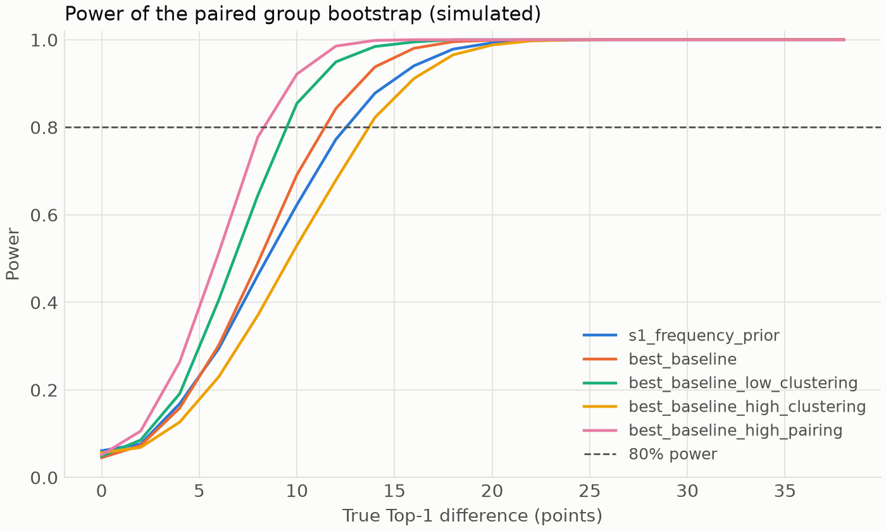

# Power analysis

Generated by `cascadelens eval power`. Do not edit by hand.

- Groups: 75; cases: 375, from `data/splits/group_run/groups.parquet`.
- Data manifest checksum: `b1ae69bc89350088eef88b25483b46d520416ec1bdf2eb9c9e3a4c48690823d3`.
- Config hash: `f1359e57c88ba10e9a66e62abfda2684b86eb64670ff341374b8d555c7dbae3f`.
- 2000 simulations per point; 4000 group-bootstrap resamples; target power 80%; seed 0.

## Assumptions

These values are assumed, not measured: no model result exists yet.

| Scenario | Baseline Top-1 | Within-group correlation | Paired correlation |
| --- | --- | --- | --- |
| s1_frequency_prior | 0.20 | 0.50 | 0.20 |
| best_baseline | 0.60 | 0.50 | 0.50 |
| best_baseline_low_clustering | 0.60 | 0.20 | 0.50 |
| best_baseline_high_clustering | 0.60 | 0.80 | 0.50 |
| best_baseline_high_pairing | 0.60 | 0.50 | 0.80 |

## Minimum detectable Top-1 difference

| Scenario | False positive rate at alpha 0.05 | MDE at alpha 0.05 (points) | MDE at alpha 0.01 (points) | Half-width at no difference (points) | Power of the 12-point S2 margin at no difference |
| --- | --- | --- | --- | --- | --- |
| s1_frequency_prior | 0.061 | 12.5 | 15.4 | 7.7 | 0.83 |
| best_baseline | 0.045 | 11.4 | 13.8 | 8.1 | 0.81 |
| best_baseline_low_clustering | 0.049 | 9.5 | 11.5 | 6.7 | 0.94 |
| best_baseline_high_clustering | 0.057 | 13.7 | 16.5 | 9.8 | 0.66 |
| best_baseline_high_pairing | 0.051 | 8.3 | 10.0 | 5.8 | 0.97 |

Holm correction over five primary criteria tests the smallest p-value at alpha / 5, which is the second alpha column when it is 0.01.

## How to read this

- The test is the two-sided percentile interval of the paired group bootstrap (S1).
- Power depends on the number of groups far more than on the number of cases, and repetitions of one run add little when they tend to succeed or fail together.
- The simulation holds each case's outcomes as given, so it leaves out variation from training on different folds, so real power is likely to be lower.
- S3 and S4 are not simulated here. A difference of differences has a standard error about sqrt(2 * (1 - r)) times that of one difference, where r correlates the clean and perturbed margins across groups.

