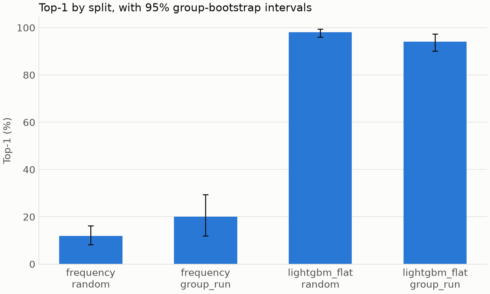

# Leakage demonstration

Generated by `cascadelens experiments leakage-demo`.

For frequency, Top-1 was 12.0% on the random split and 20.0% on group_run, a paired gap of -8.0 points (95% CI -18.4 to 1.9), so the random split had no clear effect on it. For lightgbm_flat, Top-1 was 98.0% on the random split and 94.0% on group_run, a paired gap of 4.0 points (95% CI 0.8 to 7.7), so the random split inflated it.

| Method | Split | Top-1 | Top-3 | Avg@5 |
| --- | --- | --- | --- | --- |
| frequency | random | 12.0 [8.3, 16.3] | 47.7 [42.7, 53.1] | 51.7 [49.0, 54.6] |
| frequency | group_run | 20.0 [12.0, 29.3] | 60.0 [48.0, 70.7] | 60.0 [53.6, 66.7] |
| lightgbm_flat | random | 98.0 [96.1, 99.5] | 99.3 [98.5, 100.0] | 99.1 [98.0, 99.9] |
| lightgbm_flat | group_run | 94.0 [90.1, 97.4] | 98.6 [97.0, 99.7] | 97.7 [96.0, 99.1] |

Paired difference, random minus group_run, in points:

| Method | Metric | Difference [95% CI] | p |
| --- | --- | --- | --- |
| frequency | Top-1 | -8.0 [-18.4, 1.9] | 0.1346 |
| frequency | Top-3 | -12.3 [-23.5, -0.8] | 0.0384 |
| frequency | Avg@5 | -8.3 [-15.4, -1.3] | 0.0194 |
| lightgbm_flat | Top-1 | 4.0 [0.8, 7.7] | 0.0102 |
| lightgbm_flat | Top-3 | 0.7 [-0.3, 2.1] | 0.2334 |
| lightgbm_flat | Avg@5 | 1.4 [0.2, 2.9] | 0.0164 |

Scores are percentages with 95% group-bootstrap intervals. Both splits use the same groups, cases and settings.

