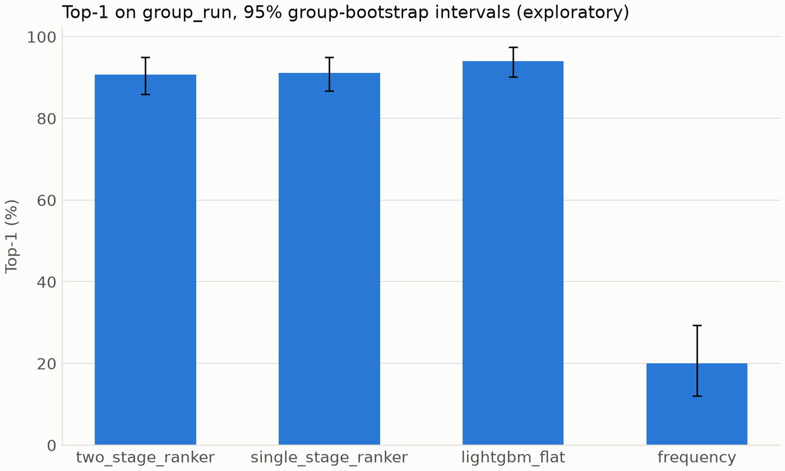

# Clean-data ranker

Generated by `cascadelens experiments ranker-clean`. **Status: exploratory.**

The config is not frozen, so nothing here is a pre-registered test result. S1 and S2 below are previews of the planned tests.

Scores are percentages with 95% group-bootstrap intervals, averaged per case over seeds. A case whose truth was not retrieved is a miss. Comparisons are paired, with a Wilcoxon check on group means. Holm over the five primary criteria needs S3, S4 and S7, so raw p-values are shown here and `holm_upper_bound` in the JSON is the worst case.

## Group_run

| Method | Top-1 | Top-3 | Avg@5 |
| --- | --- | --- | --- |
| two_stage_ranker | 90.7 [85.9, 94.9] | 97.4 [95.5, 99.0] | 96.1 [93.9, 98.1] |
| single_stage_ranker | 91.2 [86.7, 95.0] | 97.0 [94.4, 99.1] | 96.2 [93.7, 98.2] |
| lightgbm_flat | 94.0 [90.1, 97.4] | 98.6 [97.0, 99.7] | 97.7 [96.0, 99.1] |
| frequency | 20.0 [12.0, 29.3] | 60.0 [48.0, 70.7] | 60.0 [53.6, 66.7] |

## Paired comparisons on group_run

| Comparison | Difference, points [95% CI] | Bootstrap p | Wilcoxon p |
| --- | --- | --- | --- |
| S1: ranker minus frequency, Top-1 | 70.7 [60.6, 80.2] | 0.0002 | 0.0000 |
| S2: ranker minus lightgbm_flat, plus 12.0 margin | 8.6 [5.9, 11.3] | 0.0002 | 0.0000 |
| Ranker minus lightgbm_flat, no margin | -3.4 [-6.1, -0.7] | 0.0164 | 0.0066 |
| Two-stage minus single-stage, Top-1 | -0.5 [-3.0, 1.9] | 0.7045 | 0.9677 |
| Two-stage minus single-stage, Top-3 | 0.4 [-0.6, 1.5] | 0.5195 | 0.6366 |
| Two-stage minus single-stage, Avg@5 | -0.1 [-1.1, 1.0] | 0.9501 | 0.9329 |

S2 needs the margin-shifted interval to lie above zero.

### LOFO and LOSO per fold

| Method | Split | Fold | Cases | Random floor | Top-1 | Top-3 | Avg@5 |
| --- | --- | --- | --- | --- | --- | --- | --- |
| two_stage_ranker | lofo | cpu | 75 | 4.3 | 99.7 [99.2, 100.0] | 100.0 [100.0, 100.0] | 99.9 [99.8, 100.0] |
| two_stage_ranker | lofo | delay | 75 | 4.5 | 76.8 [65.6, 86.9] | 94.7 [86.7, 100.0] | 91.0 [83.4, 96.3] |
| two_stage_ranker | lofo | disk | 75 | 4.6 | 97.3 [94.7, 99.5] | 100.0 [100.0, 100.0] | 99.4 [98.7, 99.9] |
| two_stage_ranker | lofo | loss | 75 | 4.5 | 73.3 [58.1, 87.5] | 86.7 [77.9, 94.4] | 84.4 [75.0, 93.0] |
| two_stage_ranker | lofo | mem | 75 | 4.3 | 98.1 [96.0, 100.0] | 100.0 [100.0, 100.0] | 99.6 [99.2, 100.0] |
| two_stage_ranker | loso | online-boutique | 125 | 7.5 | 79.4 [68.8, 88.6] | 89.6 [80.6, 96.8] | 87.8 [79.4, 95.0] |
| two_stage_ranker | loso | sock-shop | 125 | 4.4 | 96.6 [92.2, 99.5] | 99.5 [98.6, 100.0] | 98.9 [97.3, 99.9] |
| two_stage_ranker | loso | train-ticket | 125 | 1.4 | 73.8 [62.6, 84.3] | 89.9 [83.0, 95.8] | 87.3 [80.6, 93.3] |
| single_stage_ranker | lofo | cpu | 75 | 4.3 | 91.2 [81.9, 98.4] | 99.2 [97.6, 100.0] | 97.6 [94.5, 99.7] |
| single_stage_ranker | lofo | delay | 75 | 4.5 | 77.1 [62.7, 89.1] | 94.4 [85.6, 100.0] | 91.3 [83.1, 97.0] |
| single_stage_ranker | lofo | disk | 75 | 4.6 | 87.2 [77.1, 95.2] | 97.9 [94.7, 100.0] | 95.4 [90.8, 98.7] |
| single_stage_ranker | lofo | loss | 75 | 4.5 | 74.7 [59.7, 87.7] | 89.9 [79.7, 97.3] | 86.7 [76.6, 94.7] |
| single_stage_ranker | lofo | mem | 75 | 4.3 | 95.7 [93.3, 97.9] | 99.7 [99.2, 100.0] | 98.8 [98.1, 99.5] |
| single_stage_ranker | loso | online-boutique | 125 | 7.5 | 64.2 [50.7, 77.0] | 86.9 [80.3, 92.6] | 82.6 [75.7, 89.0] |
| single_stage_ranker | loso | sock-shop | 125 | 4.4 | 88.8 [81.6, 94.9] | 99.4 [98.4, 100.0] | 96.9 [94.8, 98.7] |
| single_stage_ranker | loso | train-ticket | 125 | 1.4 | 56.5 [44.6, 68.2] | 77.1 [68.0, 85.4] | 73.3 [64.2, 81.9] |

The random floor is the expected Top-1 of picking uniformly among a case's services.

## Validation versus test, and retrieval recall

Means over seeds. K and hyperparameters were chosen on validation for each fold. Validation also set early stopping, so it runs optimistic. Recall@K bounds Top-1.

| Method | Split | Fold | K | Recall@K | Val Top-1 | Test Top-1 | Val minus test |
| --- | --- | --- | --- | --- | --- | --- | --- |
| two_stage_ranker | group_run | 0 | 8 | 98.7 | 91.3 | 92.0 | -0.7 |
| two_stage_ranker | group_run | 1 | 8 | 100.0 | 88.0 | 86.4 | 1.6 |
| two_stage_ranker | group_run | 2 | 8 | 100.0 | 92.0 | 94.1 | -2.1 |
| two_stage_ranker | group_run | 3 | 8 | 100.0 | 94.3 | 89.9 | 4.5 |
| two_stage_ranker | group_run | 4 | 5 | 98.7 | 99.0 | 90.9 | 8.1 |
| two_stage_ranker | lofo | 0 | 5 | 100.0 | 93.0 | 99.7 | -6.7 |
| two_stage_ranker | lofo | 1 | 8 | 100.0 | 94.3 | 76.8 | 17.5 |
| two_stage_ranker | lofo | 2 | 5 | 100.0 | 95.0 | 97.3 | -2.3 |
| two_stage_ranker | lofo | 3 | 8 | 97.3 | 95.7 | 73.3 | 22.3 |
| two_stage_ranker | lofo | 4 | 8 | 100.0 | 95.3 | 98.1 | -2.8 |
| two_stage_ranker | loso | 0 | 5 | 92.0 | 98.8 | 79.4 | 19.4 |
| two_stage_ranker | loso | 1 | 8 | 100.0 | 98.4 | 96.6 | 1.8 |
| two_stage_ranker | loso | 2 | 5 | 96.0 | 100.0 | 73.8 | 26.2 |
| single_stage_ranker | group_run | 0 | - | - | 93.3 | 93.6 | -0.3 |
| single_stage_ranker | group_run | 1 | - | - | 92.3 | 90.4 | 1.9 |
| single_stage_ranker | group_run | 2 | - | - | 97.0 | 92.8 | 4.2 |
| single_stage_ranker | group_run | 3 | - | - | 92.7 | 91.2 | 1.5 |
| single_stage_ranker | group_run | 4 | - | - | 98.7 | 88.0 | 10.7 |
| single_stage_ranker | lofo | 0 | - | - | 95.3 | 91.2 | 4.1 |
| single_stage_ranker | lofo | 1 | - | - | 94.0 | 77.1 | 16.9 |
| single_stage_ranker | lofo | 2 | - | - | 98.7 | 87.2 | 11.5 |
| single_stage_ranker | lofo | 3 | - | - | 98.7 | 74.7 | 24.0 |
| single_stage_ranker | lofo | 4 | - | - | 91.3 | 95.7 | -4.4 |
| single_stage_ranker | loso | 0 | - | - | 96.8 | 64.2 | 32.6 |
| single_stage_ranker | loso | 1 | - | - | 98.0 | 88.8 | 9.2 |
| single_stage_ranker | loso | 2 | - | - | 100.0 | 56.5 | 43.5 |

## Gain share by feature group, group_run

| Method | Group | Share of gain |
| --- | --- | --- |
| two_stage_ranker | graph | 0.4 |
| two_stage_ranker | mask | 0.1 |
| two_stage_ranker | signal | 99.0 |
| two_stage_ranker | structural | 0.3 |
| two_stage_ranker | temporal | 0.3 |
| single_stage_ranker | graph | 0.5 |
| single_stage_ranker | mask | 0.1 |
| single_stage_ranker | signal | 99.0 |
| single_stage_ranker | structural | 0.2 |
| single_stage_ranker | temporal | 0.2 |

Per-fold shares and top columns are in `results.json`.

## Warnings

None.
